# PlantVision — Plant Leaf Disease Classifier

[](https://pytorch.org)
[](https://pytorch.org)
[](https://streamlit.io)
[](https://python.org)
[](tests/)
[](LICENSE)

An end-to-end PyTorch computer vision system comparing an empirical scratch Convolutional Neural Network (CNN) against transfer learning with fine-tuned **ResNet-18** for multi-crop pathology diagnosis across 38 categories in the **PlantVillage** dataset.

Engineered with cryptographic SHA-256 data-leakage elimination, specimen-isolated validation/test partitions, multi-stage latency profiling with CUDA stream synchronization, selective classification confidence gating, and an interactive Streamlit diagnostic application.

---

## Key Results at a Glance

| Metric | Custom Baseline CNN | ResNet-18 (Transfer Learning) | Improvement / Delta |
| :--- | :---: | :---: | :---: |
| **Top-1 Accuracy** | 88.96% | **99.03%** | **+10.07%** |
| **Top-3 Accuracy** | 98.06% | **99.94%** | **+1.88%** |
| **Macro-Averaged F1** | 0.8587 | **0.9871** | **+0.1284** |
| **Balanced Accuracy** | 89.62% | **98.93%** | **+9.31%** |
| **Expected Calibration Error (ECE)** | — | **0.0040** (15 bins) | Highly Calibrated |
| **Selective Accuracy ($\tau^*=0.72$)** | — | **99.56%** (98.52% coverage) | 55.7% Error Reduction |
| **Median Inference Latency (B=1)** | **2.54 ms** | 3.28 ms | Steady-State GPU |
| **Batch Throughput (B=16)** | **1,726.5 img/s** | 1,101.0 img/s | High Throughput |
| **Trainable Parameters** | **464,454** | 11,196,006 | 24x Capacity |

---

## 1. System Architecture

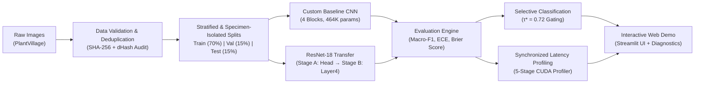

---

## 2. Dataset & Integrity Engineering

* **Dataset:** [PlantVillage Dataset](https://github.com/spMohanty/PlantVillage-Dataset) (Mohanty et al., 2016).
* **Coverage:** 54,284 valid images across **38 classes** (14 crop species, 26 pathological conditions + healthy controls).
* **Classes:** Apple, Blueberry, Cherry, Corn, Grape, Orange, Peach, Bell Pepper, Potato, Raspberry, Soybean, Squash, Strawberry, and Tomato.

### Dataset Class Distribution
The dataset exhibits significant natural class imbalance, ranging from 275 images (Potato Healthy) to over 5,000 images (Soybean and Tomato categories).

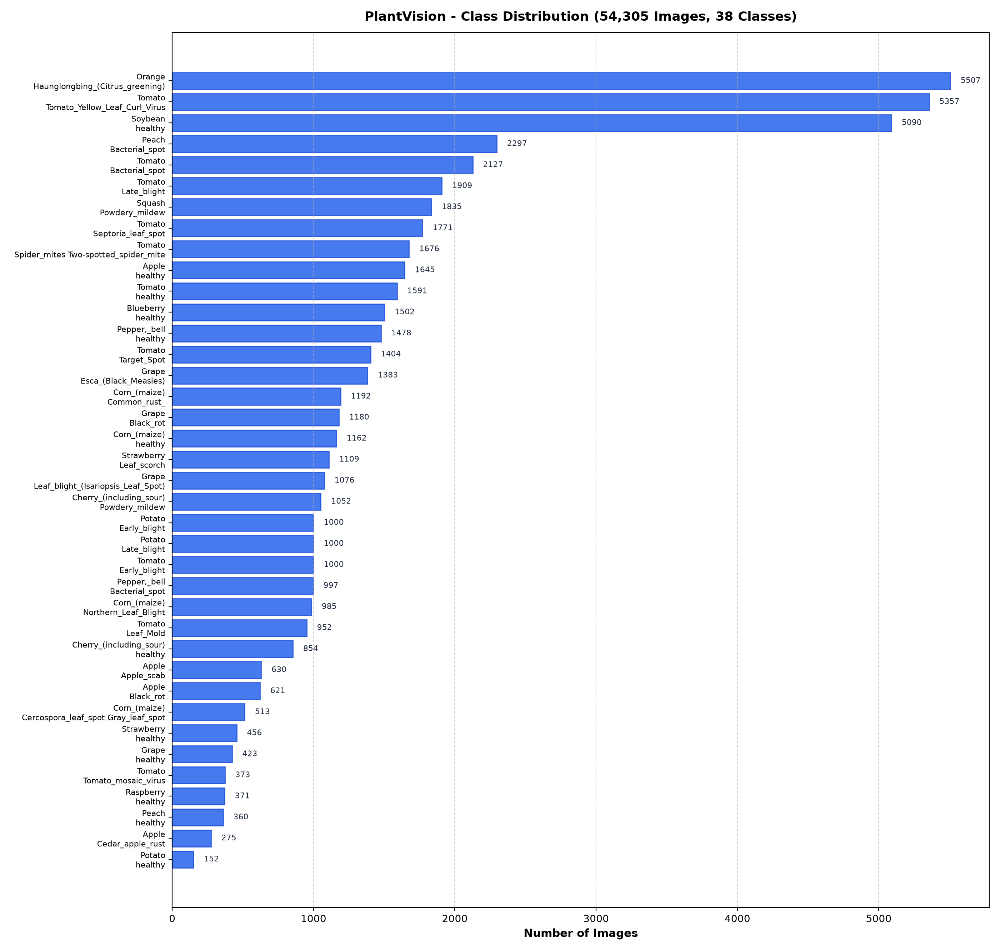

### Data Leakage Audit & Specimen Independence
Image classification benchmarks frequently suffer from cross-split data leakage due to duplicate frames or multiple photos of the same physical leaf. PlantVision addresses this systematically:

1. **Exact Duplicate Hashing:** Computed SHA-256 byte hashes across all 54,284 images. Exact duplicates were pruned prior to splitting.
2. **Perceptual Near-Duplicate Audit:** Evaluated all 2.28+ million cross-split candidate pairs using 64-bit difference hashing (`dHash`) indexed via Multi-Index Hashing (MIH). Verified **0 train-to-test leakage pairs** ($\text{MAE} \le 15.0$).
3. **Specimen Isolation:** Resolved benchmark burst-photo overlap between validation and test splits using per-class greedy grouped partitioning (`leaf-map.json`), reducing physical specimen overlap from 2,118 shared leaves to **0 shared leaves** between evaluation splits.

---

## 3. Training & Convergence Dynamics

### Two-Stage Transfer Learning Protocol
ResNet-18 was trained via a two-stage fine-tuning strategy to prevent catastrophic forgetting:
* **Stage A (Head Warmup):** Backbone frozen (`requires_grad=False`). Classification head trained with $\eta = 10^{-3}$ for 4 epochs using AdamW and inverse-frequency class weighting.
* **Stage B (Differential Fine-Tuning):** High-level residual block (`layer4`) unfrozen. Backbone fine-tuned at $\eta = 10^{-4}$ while head trained at $\eta = 5 \times 10^{-4}$ with Cosine Annealing learning rate schedule.

| Custom Baseline CNN (4 Blocks from Scratch) | ResNet-18 Two-Stage Transfer Learning |
| :---: | :---: |
| 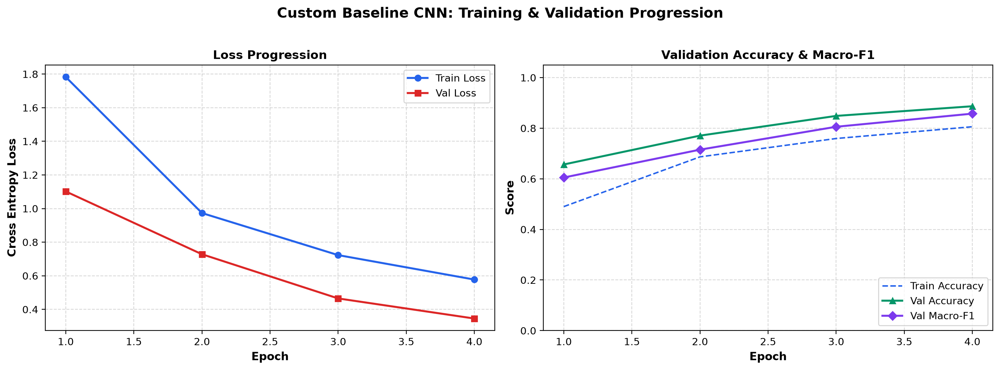 | 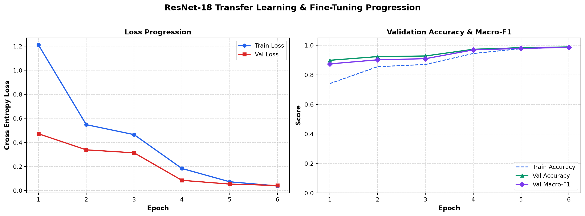 |

---

## 4. Empirical Evaluation & Error Diagnostics

### Confusion Matrix Analysis
Evaluated on an isolated test set of **8,133 held-out images** never observed during model training or checkpoint selection:

| Baseline CNN (88.96% Top-1 Accuracy) | ResNet-18 (99.03% Top-1 Accuracy) |
| :---: | :---: |
| 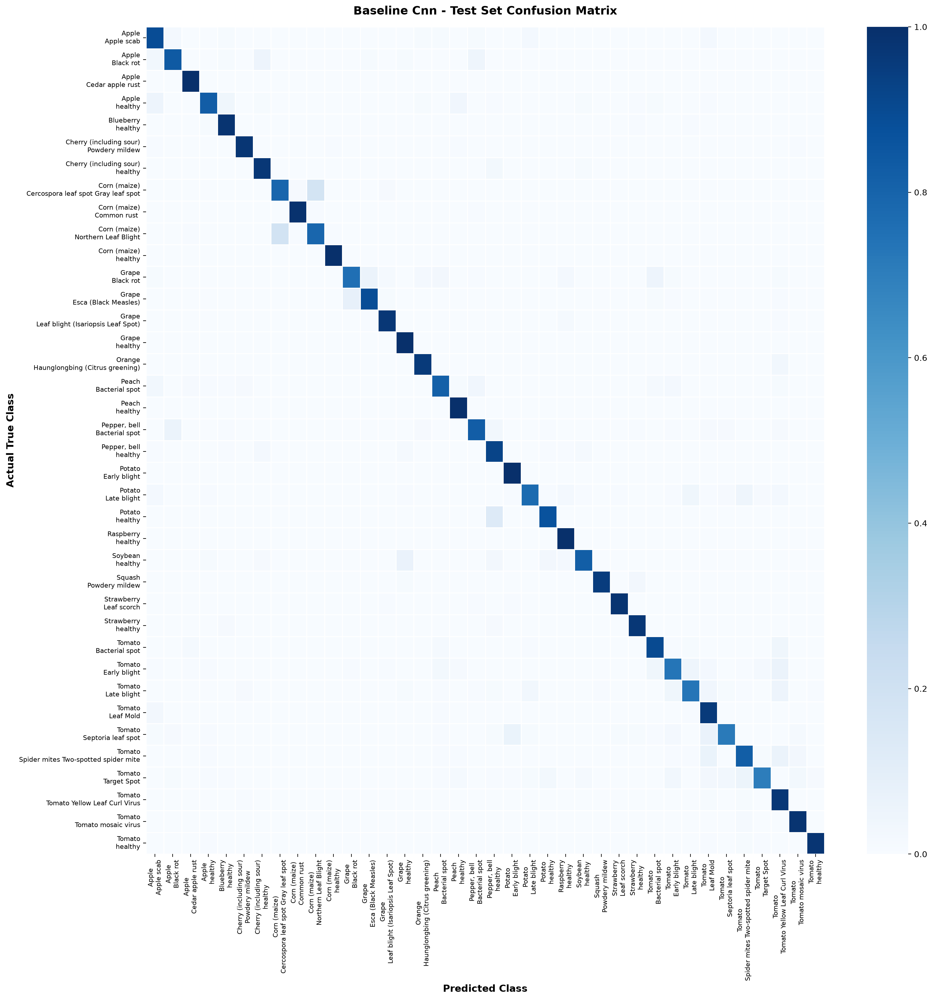 | 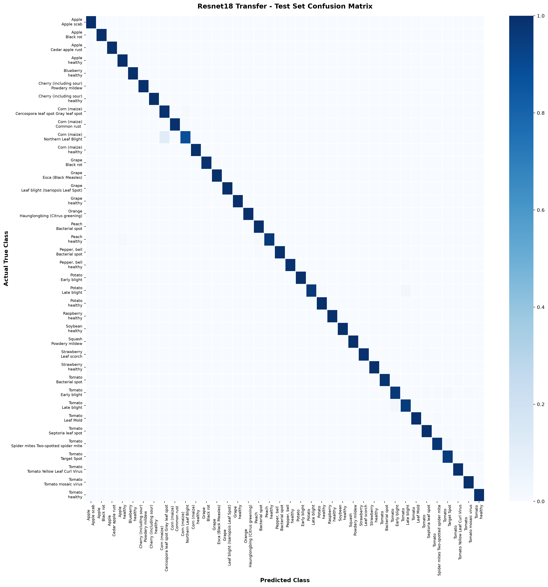 |

### Top Misclassification Pairs
Residual errors in ResNet-18 occur almost exclusively between botanically or symptomatically adjacent conditions (e.g., *Tomato Early Blight* vs. *Tomato Target Spot*, or *Corn Gray Leaf Spot* vs. *Corn Northern Leaf Blight*):

| Baseline CNN Top Confusions | ResNet-18 Top Confusions |
| :---: | :---: |
| 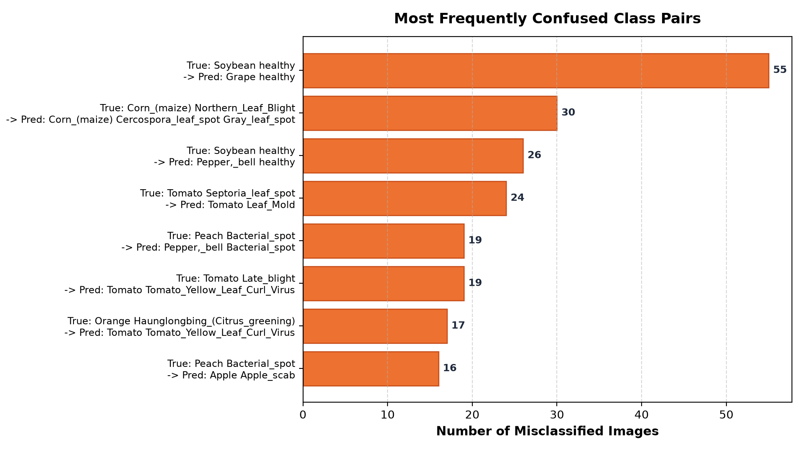 | 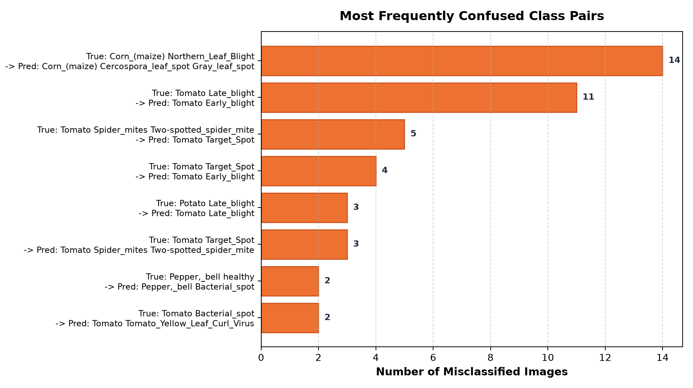 |

### Qualitative Error Analysis Grid
Visual audit of misclassified test samples with ground truth labels, model predictions, and predicted confidence scores:

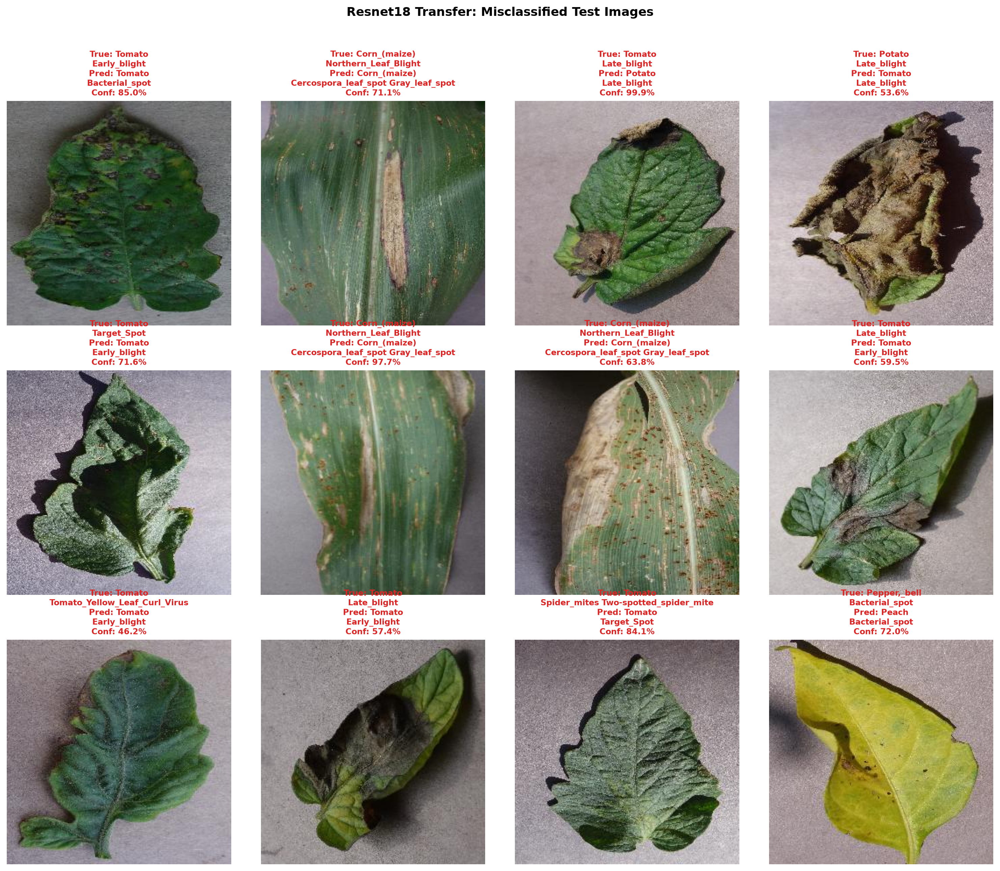

---

## 5. Model Calibration & Selective Classification

In mission-critical agricultural diagnosis, prediction uncertainty must reflect empirical correctness. A model should be confident when correct and uncertain when making errors.

| Confidence Distribution: Correct vs. Error | Test Split Reliability Diagram |
| :---: | :---: |
| 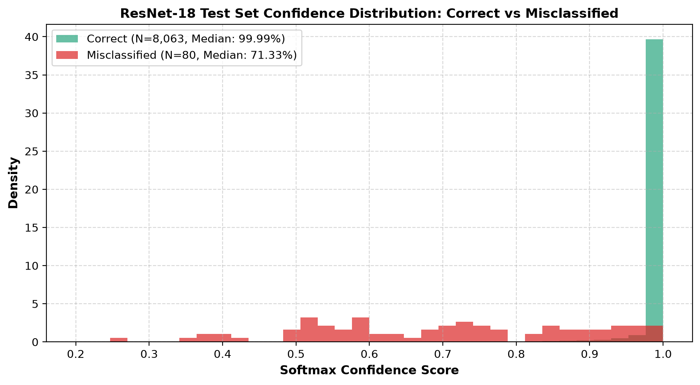 | 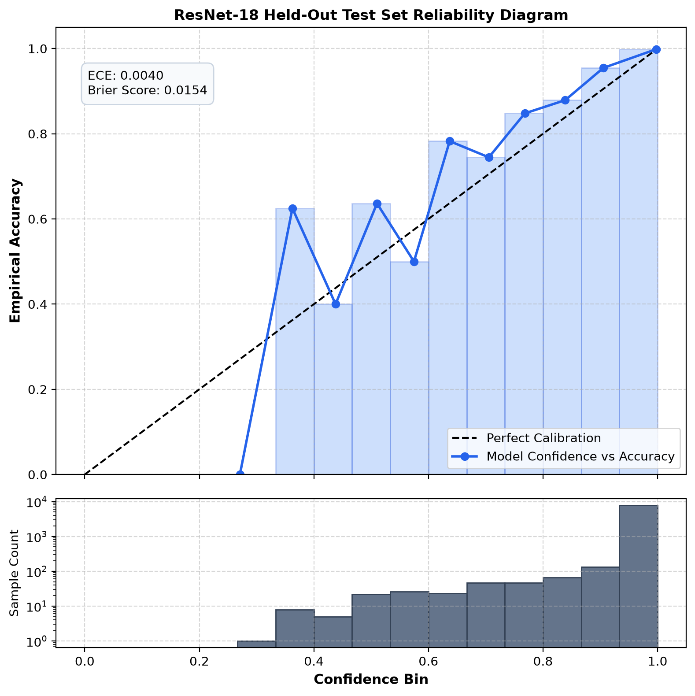 |

* **Expected Calibration Error (ECE):** Top-label ECE is **0.0029** on validation and **0.0040** on test (15 equal-width bins), demonstrating near-perfect alignment between softmax probabilities and empirical accuracy.
* **Multiclass Brier Score:** **0.0154** on test, demonstrating high confidence sharpness without probability overestimation.

### Selective Classification (Rejection Gating)
Using a confidence threshold $\tau^* = 0.72$ selected strictly on validation data ($\ge 99.5\%$ target accuracy):
* **Coverage:** Retains **98.52%** of incoming images (8,013 / 8,133).
* **Selective Test Accuracy:** Increases from **99.03% to 99.56%**.
* **Error Reduction:** Intercepts 44 out of 79 test errors (55.7% error reduction), routing uncertain leaves for manual specialist inspection.

| Threshold ($\tau$) | Validation Coverage | Validation Accuracy | Test Coverage | Test Selective Accuracy | Operational Role |
| :---: | :---: | :---: | :---: | :---: | :--- |
| **0.00** | 100.00% | 98.87% | 100.00% | 99.03% | Unfiltered baseline (79 test errors) |
| **0.50** | 99.82% | 98.97% | 99.75% | 99.12% | Minimal rejection |
| **0.70** | 98.80% | 99.42% | 98.73% | 99.48% | High coverage |
| **0.72 ($\tau^*$)** | **98.58%** | **99.50%** | **98.52%** | **99.56%** | **Validation-derived threshold (35 errors remaining)** |
| **0.80** | 97.95% | 99.60% | 97.81% | 99.66% | Strict precision triage |
| **0.90** | 96.41% | 99.80% | 96.40% | 99.78% | High confidence tier |

---

## 6. Latency Profiling & Serving Breakdown

To analyze the performance characteristics between single-invocation CLI commands and continuous web server deployments, inference was profiled through a 5-stage timer with explicit CUDA stream synchronization (`torch.cuda.synchronize()`).

**Benchmark Hardware:** AMD Ryzen 5 5600 (6-core/12-thread), NVIDIA GeForce GTX 1660 SUPER (6GB VRAM), Windows 11.

```
Cold Process Invocation (CLI) ──────────────────────────────────────── 509.17 ms
├── Checkpoint Loading & Disk I/O (Stage 1): 260.79 ms
├── Image Decode & Preprocessing (Stage 2):   6.07 ms
├── Cold Forward Pass & CUDA Init (Stage 3): 230.74 ms
└── Postprocessing & Top-k (Stage 5):         11.57 ms

Steady-State Production Serving (Streamlit / API) ──────────────────── 21.14 ms (~47 FPS)
├── Image Decode & Preprocessing (Stage 2):   6.07 ms
├── Warm Forward Pass (Stage 4, Median):       3.50 ms (p95: 5.42 ms)
└── Postprocessing & Top-k (Stage 5):         11.57 ms
```

| Pipeline Stage | ResNet-18 (224×224) | Baseline CNN (64×64) | Measurement Scope |
| :--- | :---: | :---: | :--- |
| **1. Checkpoint Deserialization** | **260.79 ms** | 9.66 ms | `torch.load` and VRAM state allocation (one-time cold cost). |
| **2. Image Decode & Transforms** | **6.07 ms** | 1.97 ms | PIL decode, RGB conversion, tensor transform, normalization. |
| **3. Cold Forward Pass** | **230.74 ms** | 5.17 ms | CUDA runtime initialization and cuDNN kernel autotuning. |
| **4. Warm Forward Pass (Median)** | **3.50 ms** | 1.02 ms | Steady-state forward pass (15 warmup passes discarded). |
| **5. Postprocessing** | **11.57 ms** | 0.16 ms | Softmax, CPU transfer, Top-k sorting, class name mapping. |
| **End-to-End Warm Serving** | **21.14 ms** (~47 FPS) | **3.15 ms** (~317 FPS) | Steady-state per-request latency in a persistent service. |
| **End-to-End Cold Execution** | **509.17 ms** | 16.96 ms | Complete cold CLI invocation from disk. |

*In production deployments (e.g. Streamlit, FastAPI), running a single dummy warmup pass at startup guarantees all subsequent requests execute at the steady-state **~21 ms end-to-end latency**.*

---

## 7. Project Structure

```
PlantVision/
├── configs/
│   └── config.yaml                 # Centralized training & pipeline parameters
├── data/
│   ├── raw/PlantVillage/           # Local raw image dataset (git-ignored)
│   ├── splits/                     # train.csv, val.csv, test.csv, classes.json
│   └── processed/
├── docs/
│   └── methodology.md              # Mathematical formulations and architecture specs
├── models/                         # Checkpoints with complete training metadata (.pt)
│   ├── baseline_cnn_best.pt
│   └── resnet18_transfer_best.pt
├── notebooks/
│   └── 01_dataset_exploration.ipynb# EDA, corruption check, duplicate audit
├── reports/
│   ├── model_comparison.csv        # Comprehensive benchmark metrics
│   ├── calibration_audit.json      # ECE, Brier score, selective threshold data
│   ├── latency_breakdown.json      # 5-stage synchronized latency profiling
│   └── figures/                    # High-res diagnostic plots and error grids
├── scripts/
│   ├── download_dataset.py         # Automated download & extraction
│   ├── prepare_dataset.py          # Validation, deduplication, and stratified splitting
│   ├── train_baseline.py           # Trains custom scratch CNN
│   ├── train_transfer_learning.py  # Two-stage fine-tuning for ResNet-18
│   ├── evaluate_model.py           # Evaluation on isolated test set & figure generation
│   ├── audit_calibration.py        # Reliability diagrams & selective classification
│   └── run_pipeline.py             # End-to-end automated pipeline
├── src/
│   └── plantvision/                # Modular Python package
│       ├── benchmark.py            # Latency & throughput benchmarking suite
│       ├── calibration.py          # ECE, Brier score, rejection threshold logic
│       ├── config.py               # YAML configuration manager
│       ├── data_validation.py      # Duplicate hashing & dataset verification
│       ├── dataset.py              # PyTorch Dataset & DataLoader pipelines
│       ├── evaluate.py             # Classification report & error isolation
│       ├── models.py               # Baseline CNN & ResNet-18 architectures
│       ├── predict.py              # Standalone inference engine with warmup & timing
│       ├── train.py                # Training loop with validation checkpointing
│       ├── transforms.py           # ImageNet preprocessing & conservative augmentations
│       └── visualize.py            # Matplotlib / Seaborn visualization utilities
├── tests/                          # 29 automated unit tests (pytest)
├── app.py                          # Streamlit web demonstration application
├── pyproject.toml                  # Package configuration & tool settings
└── requirements.txt                # Pinned production dependencies
```

---

## 8. Installation & Quickstart

### Prerequisites
* Python 3.10, 3.11, or 3.12
* NVIDIA GPU with CUDA support recommended, or CPU.

### Setup
```bash
# Clone repository
git clone https://github.com/Looka-info/Computer-vision-classifier.git
cd "Computer-vision-classifier"

# Create and activate virtual environment
python -m venv .venv
source .venv/bin/activate        # Linux/macOS
# .\.venv\Scripts\Activate.ps1   # Windows PowerShell

# Install PyTorch with CUDA 12.4 (or CPU / cu121)
pip install torch torchvision --index-url https://download.pytorch.org/whl/cu124

# Install package and dependencies
pip install -r requirements.txt -e .
```

### End-to-End Execution Commands

```bash
# 1. Download and extract PlantVillage dataset
python scripts/download_dataset.py

# 2. Validate data, remove duplicates, and generate leak-free splits
python scripts/prepare_dataset.py

# 3. Train models
python scripts/train_baseline.py
python scripts/train_transfer_learning.py

# 4. Evaluate on isolated test set and generate diagnostic figures
python scripts/evaluate_model.py --all

# 5. Run calibration and selective classification audit
python scripts/audit_calibration.py

# 6. Benchmark latency and throughput
python -m plantvision.benchmark --arch resnet18

# 7. Single image CLI prediction
python -m plantvision.predict --image path/to/leaf.jpg --model models/resnet18_transfer_best.pt

# 8. Launch interactive Streamlit demo
streamlit run app.py

# 9. Run test suite
pytest -v
```

---

## 9. Verification & Test Suite

The test suite covers data validation, leakage elimination, architecture definitions, inference execution, and calibration mathematics:

```bash
pytest -v
```

```
tests/test_benchmark.py::test_hardware_info_structure PASSED             [  3%]
tests/test_benchmark.py::test_benchmark_preprocessing PASSED             [  6%]
tests/test_benchmark.py::test_benchmark_model_inference_output PASSED    [ 10%]
tests/test_calibration.py::test_multiclass_brier_score_bounds PASSED     [ 13%]
tests/test_calibration.py::test_compute_calibration_metrics PASSED       [ 17%]
tests/test_calibration.py::test_evaluate_selective_classification PASSED [ 20%]
tests/test_calibration.py::test_select_threshold_from_validation PASSED  [ 24%]
tests/test_data.py::test_missing_dataset_directory PASSED                [ 27%]
tests/test_data.py::test_empty_class_directory PASSED                    [ 31%]
tests/test_data.py::test_scan_dataset_detects_corrupt_and_duplicates PASSED [ 34%]
tests/test_data.py::test_create_leak_free_splits_no_cross_split_duplicates PASSED [ 37%]
tests/test_data.py::test_inspect_image_file_valid_and_invalid PASSED     [ 41%]
tests/test_data.py::test_dhash_and_hamming_distance PASSED               [ 44%]
tests/test_data.py::test_evaluation_splits_zero_specimen_overlap PASSED  [ 48%]
tests/test_data.py::test_cherry_powdery_mildew_leaf5_isolation PASSED    [ 51%]
tests/test_data.py::test_near_duplicates_audit_reconciliation PASSED     [ 55%]
tests/test_models.py::test_baseline_cnn_forward_shape PASSED             [ 58%]
tests/test_models.py::test_transfer_resnet18_frozen_backbone PASSED      [ 62%]
tests/test_models.py::test_transfer_resnet18_unfreeze_stage_b PASSED     [ 65%]
tests/test_models.py::test_model_factory_dispatch PASSED                 [ 68%]
tests/test_prediction.py::test_missing_checkpoint_raises_error PASSED    [ 72%]
tests/test_prediction.py::test_prediction_valid_image PASSED             [ 75%]
tests/test_prediction.py::test_prediction_corrupt_image PASSED           [ 79%]
tests/test_prediction.py::test_prediction_from_pil_and_bytes PASSED      [ 82%]
tests/test_prediction.py::test_prediction_timing_breakdown_and_warmup PASSED [ 86%]
tests/test_training.py::test_training_smoke_step PASSED                  [ 89%]
tests/test_transforms.py::test_eval_transform_shape_and_type PASSED      [ 93%]
tests/test_transforms.py::test_train_transform_shape_and_type PASSED     [ 96%]
tests/test_transforms.py::test_eval_transform_deterministic PASSED       [100%]

============================= 29 passed in 9.73s ==============================
```

---

## 10. Operational Considerations & Deployment Advisory

* **Laboratory vs. Field Imagery:** The 99.03% test accuracy is achieved on the PlantVillage benchmark, which features single excised leaves photographed against uniform studio backgrounds under fixed lighting. Real-world deployment on mobile or drone field photography introduces covariate shifts: variable direct sunlight, specular highlights on wet leaves, background foliage, soil occlusions, and co-occurring diseases.
* **Out-of-Distribution (OOD) Gating:** Softmax probabilities reflect class distributions relative to the 38 training classes. Non-leaf or wild weed images can activate high softmax confidence. Production field systems should incorporate embedding-distance OOD gating (e.g. Mahalanobis distance) prior to disease prediction.
* **Agronomic Use:** PlantVision serves as a diagnostic screening and triage tool. Predictions should be verified alongside local agronomic extension guidelines prior to administering chemical treatments.

---

## 11. Licenses & Attribution

* **Software:** Licensed under the [MIT License](LICENSE).
* **Dataset:** [PlantVillage](https://github.com/spMohanty/PlantVillage-Dataset) by Sharada P. Mohanty, David P. Hughes, and Marcel Salathé, distributed under the Creative Commons Attribution-ShareAlike 3.0 Unported ([CC BY-SA 3.0](https://creativecommons.org/licenses/by-sa/3.0/)) license.
* **Pretrained Weights:** TorchVision ResNet-18 backbone licensed under BSD 3-Clause. Fine-tuned checkpoint redistributions should include appropriate attribution under CC BY-SA 3.0 guidelines.
